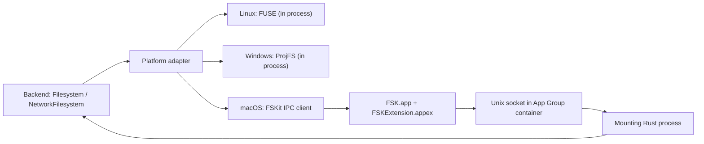

# Contributing to FSK

Thanks for helping improve FSK. This document covers the repository layout, how
each platform adapter works, how to develop the macOS FSKit extension, the
toolchain you need, and the `FSK_APP_PATH` override.

For the public API, see the crate-level documentation in `fsk/src/lib.rs`, the
[user guide](README.md), and [`fsk/macos/README.md`](fsk/macos/README.md).

## Repository layout

```
fsk/                     the published crate
  src/lib.rs             crate-level documentation and re-exports
  src/core.rs            Filesystem, Metadata, directory model, errors
  src/network.rs         NetworkFilesystem, cache policy, local-file leases
  src/raw.rs             opt-in native event types
  src/linux.rs           FUSE adapter
  src/windows.rs         ProjFS adapter
  macos/rust/mount.rs    macOS mount session and IPC server startup
  macos/rust/ipc.rs      authenticated Rust<->Swift protocol
  macos/rust/ffi.rs      in-process C ABI used by tests/compatibility clients
  macos/rust/authorization.rs  install/launch/authorize/uninstall helpers
  macos/FSKApp           Swift setup application
  macos/FSKExtension     Swift FSKit extension
  macos/FSKExtensionTests
  macos/project.yml      XcodeGen source of truth for the Xcode project
  macos/include/fsk.h    C ABI definitions shared with the Swift bridge
examples/                standalone backends (not part of the published crate)
docs/                    the user guide, synced to the Specta website
```

`docs/` is the source of truth for the user guide. It is published at
<https://specta.dev/docs/fsk> through a submodule in `specta-rs/website`, so
edit it here rather than in the website repository.

`fsk/macos/FSK.xcodeproj` is generated and checked in. Edit `project.yml`, then
regenerate the project rather than editing the project file by hand.

## Architecture

The crate exposes one portable model (`Filesystem` and
`NetworkFilesystem: Filesystem`) and three adapters. Inodes are opaque 64-bit
identifiers, directory entries are streamed into a caller-owned sink, and reads
and writes use caller-provided buffers. The backend owns inode indexing,
caching, locking, consistency, and persistence.



### macOS

macOS uses a two-process design because FSKit extensions must run in an app
extension, not in the process that owns the backend.

1. `fsk::MountSession::mount` (or `mount_network`) starts an authenticated IPC
   server inside the calling Rust process. It creates a mode-0600 Unix socket
   under `~/Library/Group Containers/group.dev.specta.fsk/Runtime/` and a random
   32-byte capability.
2. It runs `/sbin/mount -F -t fsk` with a resource URL of the form
   `fsk://mount?socket=<percent-encoded path>&token=<hex capability>`.
3. macOS asks the registered FSKit extension to load that resource.
   `FSKFileSystem` (Swift) parses the URL and `RustBackend` connects to the
   socket, authenticates with a `HELLO` frame carrying the capability, and
   forwards `FSVolume` operations over a framed, pooled connection (between 4
   and 32 connections, scaled to the active CPU count).
4. The Rust process decodes each request, calls the user's `Filesystem`
   implementation, and returns the response. The Swift `FSKVolume` maps the
   portable model onto `FSItem` and `FSVolume` APIs.
5. Dropping `MountSession` unmounts with `diskutil`, stops the accept loop,
   closes the socket, and drops outstanding local-file leases.

The extension is sandboxed and uses the `group.dev.specta.fsk` app group to
reach the socket; it also carries `com.apple.developer.fskit.fsmodule`.

`FSK.app` is not a daemon: it is an `LSUIElement` setup utility that reports
authorization state and opens the File System Extensions pane. It is installed
per-user in the hidden directory
`~/Library/Application Support/dev.specta.fsk/FSK.app`; the extension lives at
`FSK.app/Contents/Extensions/FSKExtension.appex`.

Because the extension is out of process, Objective-C and FSKit pointers cannot
cross the boundary. Raw events for macOS therefore carry stable identifiers and
the exact borrowed IPC payload instead of native pointers.

### Linux

Linux is a single-process FUSE adapter built on `fuser`.

- `MountSession::mount` starts a background FUSE session with one dispatcher
  thread per configured worker (`MountOptions::worker_threads`), cloning the
  FUSE descriptor for concurrent workers.
- Every FUSE callback calls the corresponding `Filesystem` method. Directory
  entries are packed into the reply buffer; reads reuse a per-thread buffer to
  avoid per-request allocation.
- `MountOptions` also controls read-only mounts, kernel permission checks, and
  metadata TTL.
- For network backends, opening a `NetworkFile::Local` makes the adapter hold a
  descriptor and answer reads with `pread`, bypassing `Filesystem::read`.
- Raw events expose the live `fuser::Request`, the FUSE unique id, the file
  handle, open flags, and the read/write buffer.

At runtime the machine needs a working FUSE installation and access to
`/dev/fuse`. `authorization_status()` reports `NeedsApproval` when `/dev/fuse`
is missing, and `ensure_authorization()` returns the FUSE requirement as an
actionable error.

### Windows

Windows is a single-process ProjFS provider.

- `MountSession::mount` marks the target directory as a placeholder and calls
  `PrjStartVirtualizing` with callbacks for directory enumeration, placeholder
  information, file data, notifications, and cancellation.
- Names are converted between Windows UTF-16 and WTF-8, so unpaired surrogates
  round-trip without loss.
- `MountOptions` controls read-only behavior, worker counts, and the ProjFS
  negative path cache.
- ProjFS merges projected entries with files hydrated into the Windows cache.
  Local edits stay in that cache; providers observe them through raw
  notification events. This is intentionally different from owning all write
  semantics. A WinFsp adapter can be added later without changing the portable
  model.
- ProjFS never evicts hydrated content on its own. `MountSession::evict` and
  the handle returned by `MountSession::eviction_handle` call `PrjDeleteFile`
  so a backend can return idle files to virtual placeholders; scheduling that
  cleanup is left to the backend.
- Raw events expose the borrowed `PRJ_CALLBACK_DATA`, namespace context,
  command id, callback flags, and the hydration buffer for reads.

At runtime the Projected File System optional component (`Client-ProjFS`) must
be enabled. `authorization_status()` checks whether `ProjectedFSLib.dll` is
available, and `ensure_authorization()` opens **Windows Features** and returns
the requirement when it is missing.

## Developing with the FSKit extension

macOS support requires the `FSK.app` companion. No Rust code runs inside the
extension; it talks to whichever Rust process mounted the volume.

### 1. Install the prerequisites

- macOS 26 or later, with Xcode 26 or later (CI uses Xcode 26.4.1).
- XcodeGen: `brew install xcodegen`.
- An Apple Developer team with access to the
  `com.apple.developer.fskit.fsmodule` entitlement.
- Provisioning profiles for `dev.specta.fsk` and `dev.specta.fsk.extension` if
  you sign manually (CI sets `FSK_APP_PROFILE` and `FSK_EXTENSION_PROFILE` to
  their UUIDs). For local development you can use Xcode's automatic signing
  with your own team instead.

### 2. Generate the Xcode project

`project.yml` is the source of truth:

```sh
(cd fsk/macos && xcodegen generate)
```

Re-run this after changing targets, build settings, sources, entitlements, or
the extension `Info.plist`. Commit the regenerated `fsk/macos/FSK.xcodeproj`
along with the YAML change.

### 3. Build and run

Open `fsk/macos/FSK.xcodeproj`, choose the `FSKApp` scheme, set your team under
Signing & Capabilities, and run. Xcode launches the build product from its
DerivedData directory; launching it once is enough for FSKit to register the
embedded extension. To exercise the normal lifecycle path, copy the built
`FSK.app` to `~/Library/Application Support/dev.specta.fsk/FSK.app`, or set
[FSK_APP_PATH](#fsk_app_path) to any other location for the lifecycle helpers.

Launch `FSK.app` once, then enable the extension under **System Settings →
General → Login Items & Extensions → File System Extensions**. Enabling the
switch is a per-user action; macOS exposes no API for it. The SDK helpers
`fsk::install`, `fsk::authorization_status`, `fsk::launch_app`, and
`fsk::uninstall` automate installation and opening the app, not the switch
itself.

### 4. Mount with a Rust backend

In another terminal, build and run an example that depends on the `fsk` crate:

```sh
cargo run -p fsk-memory-backend -- /tmp/fsk-memory
```

The Rust process starts the IPC service and asks macOS to mount. If the
extension is enabled, the volume appears at the mount path. Press Ctrl-C to
unmount cleanly.

To exercise a network backend instead:

```sh
cargo run -p fsk-network-backend -- /tmp/fsk-network "hello from the origin"
```

The backend runs in the Rust process. The Swift extension only translates
FSKit calls into IPC requests; no backend code is compiled into the extension.

### 5. Test and iterate

Run the full Rust and Swift suite:

```sh
./fsk/macos/check.sh
```

The script runs `cargo fmt --check`, Clippy with `-D warnings`, the workspace
tests, regenerates the Xcode project, and runs `xcodebuild test` with
`CODE_SIGNING_ALLOWED=NO`. The Swift tests cover the IPC address/encoding
helpers and local-file lease logic without needing a signed extension.

Useful iteration tips:

- After changing Swift sources, rebuild `FSKApp`; the extension is re-embedded
  in the app bundle.
- If macOS keeps using an older extension, toggle the extension off and on in
  System Settings, or reinstall the app.
- Extension logs go to the unified log. Try:
  `log stream --predicate 'process == "FSKExtension"' --level debug`.
- Mount failures from the Rust process include the `mount(8)` stderr in the
  returned error; inspect it before assuming the extension is at fault.
- The extension shares the app group with the setup app and speaks the IPC
  protocol to the mounting Rust process. When changing that protocol, update
  `fsk/macos/rust/ipc.rs`, `fsk/macos/FSKExtension/RustBackend.swift`, and the
  C ABI in `fsk/macos/include/fsk.h` together.

## `FSK_APP_PATH`

`FSK_APP_PATH` overrides the companion app location used by the macOS
lifecycle helpers. It is mainly for development builds that should not replace
the normal per-user installation.

```sh
export FSK_APP_PATH="/abs/path/to/FSK.app"
```

Rules:

- The value must be an **absolute** path.
- It must name the `.app` bundle itself, not the directory that contains it:
  `/Applications/FSK.app`, not `/Applications`.
- `..` components are rejected. Trailing separators and `.` components are
  normalized.
- An empty value is an error.
- When unset, the default is
  `~/Library/Application Support/dev.specta.fsk/FSK.app`.

It affects:

- `fsk::install()` — installs into the overridden bundle path.
- `fsk::authorization_status()` — queries the app at that path.
- `fsk::launch_app()` — opens the app at that path.
- `fsk::uninstall()` — removes the app at that path.

It does **not** change which extension FSKit has registered. Mounting resolves
the extension through LaunchServices/PlugInKit, so launch the app once from
whichever location you use and enable it in System Settings. On the default
path, `install()` and `uninstall()` also remove a legacy machine-wide
`/Applications/FSK.app`; with an override, that copy is left alone.

`install` still validates the downloaded bundle's version, bundle identifier,
code signature, team, and Gatekeeper assessment; the override only changes the
destination. A development app built with the same marketing version as the
crate is accepted by `authorization_status` without requiring the release
signing identity, which is what makes local extension development practical.

Related variables used by the installer:

- `GITHUB_TOKEN` / `GH_TOKEN` — resolve a private GitHub release through the API.
- `FSK_RELEASE_BASE_URL` — use a mirror serving
  `{base}/v{version}/FSK-v{version}.zip`.

## Tools

### Rust

- Rust 1.85 or later, edition 2024. Install with
  [rustup](https://rustup.rs).
- The macOS release builds a universal app; install both Apple targets:

  ```sh
  rustup target add aarch64-apple-darwin x86_64-apple-darwin
  ```

- For cross-platform checks from macOS:

  ```sh
  rustup target add x86_64-unknown-linux-gnu x86_64-pc-windows-msvc
  cargo check -p fsk --target x86_64-unknown-linux-gnu
  cargo check -p fsk --target x86_64-pc-windows-msvc
  ```

- Linux runtime: a working FUSE installation (`/dev/fuse` must be usable).
- Windows runtime: the `Client-ProjFS` optional feature. Building uses the MSVC
  toolchain and the `windows-sys` crate.

### Swift and Apple tooling

- Xcode 26 or later with the macOS 26 SDK. FSKit is required; the project
  deployment target is macOS 26.0.
- Swift 6 language mode (`SWIFT_VERSION = 6.0`).
- XcodeGen to generate `FSK.xcodeproj` from `fsk/macos/project.yml`.
- `xcodebuild` for headless builds and tests.
- An Apple team and provisioning profiles that grant
  `com.apple.developer.fskit.fsmodule` to the extension.

The CI matrix uses `macos-26` with Xcode 26.4.1 for the Rust and Swift checks,
`ubuntu-24.04` for Linux, and `windows-2025` for Windows.

## Checks before opening a pull request

```sh
cargo fmt --all -- --check
cargo clippy --workspace --all-targets -- -D warnings
cargo test --workspace --all-targets
cargo test --doc -p fsk
RUSTDOCFLAGS="-D warnings" cargo doc -p fsk --no-deps
```

On macOS, also run:

```sh
./fsk/macos/check.sh
```

The crate enforces `#![deny(missing_docs)]`; document every new public item and
keep intra-doc links working on Linux, macOS, and Windows builds. The CI
`rust-platforms` job also runs tests and Clippy on Linux and Windows, so keep
platform modules compiling even when you only work on one OS.

## Live mount tests

`.github/workflows/live-mounts.yml` exercises the examples against the real
GitHub and Google Drive APIs, mounting each through the Linux FUSE adapter. It
runs on changes to `fsk/` or either example, on pushes to `main`, and weekly so
credential and upstream API drift is caught even without commits.

- **GitHub** uses the workflow's built-in `GITHUB_TOKEN`, so it needs no secret
  and still runs for pull requests from forks. The API client discovers
  repositories through `/installation/repositories` when the token is an
  installation token.
- **Google Drive** needs the `GOOGLE_CLIENT_ID`, `GOOGLE_CLIENT_SECRET`, and
  `GOOGLE_DRIVE_REFRESH_TOKEN` repository secrets. The refresh token must grant
  the `https://www.googleapis.com/auth/drive` scope. The account needs a
  `fsk-ci` folder in `My Drive` containing `hello.txt` with the contents
  `hello from fsk ci\n`; set the `FSK_DRIVE_TEST_PATH` repository variable to
  override that path. The job is skipped when these secrets are absent, which
  includes fork pull requests because they cannot read secrets.

Run the same tests locally on Linux:

```sh
GITHUB_TOKEN=... GITHUB_REPOSITORY=specta-rs/fsk \
  cargo test -p fsk-github-filesystem -- --ignored live_mount
GOOGLE_DRIVE_ACCESS_TOKEN=... \
  cargo test -p fsk-google-drive -- --ignored live_mount
```

Both require a working FUSE installation, and the tests are `#[ignore]`d so
normal `cargo test` runs never touch the network.

## Releases

The release workflow triggers on `v*` tags and requires the tag to match the
crate version. When bumping a version, update all of:

- `fsk/Cargo.toml` (`version`) and refresh `Cargo.lock`;
- `fsk/macos/project.yml` (`MARKETING_VERSION` and `CURRENT_PROJECT_VERSION`);
- `fsk/macos/FSKExtension/Info.plist` (`CFBundleShortVersionString` and
  `CFBundleVersion`).

Then regenerate the Xcode project. The installer pins the release identity
(`dev.specta.fsk`, team `68994Z5PT3`) in `fsk/macos/rust/authorization.rs`; keep
it in sync with the signing team. The release job builds a universal signed and
notarized `FSK.app`, verifies Gatekeeper acceptance, publishes
`FSK-v<version>.zip`, and publishes the `fsk` crate.
