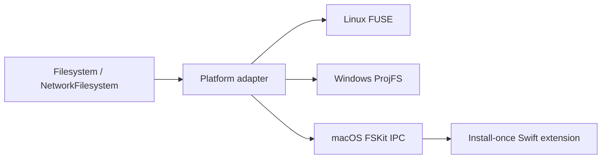

<div align="center">
  <picture>
    <source media="(prefers-color-scheme: dark)" srcset="assets/logo-dark.svg">
    
  </picture>

  <h1>FSK</h1>

  <p><strong>Build cross-platform virtual file systems with ease.</strong></p>

  <p>
    <a href="https://github.com/specta-rs/fsk/actions/workflows/ci.yml"></a>
    <a href="https://crates.io/crates/fsk"></a>
    <a href="https://docs.rs/fsk"></a>
    <a href="LICENSE"></a>
    
  </p>
</div>

<br>

FSK is a Rust toolkit for building real filesystems. Implement one trait, then
mount it as a native volume: FSKit on macOS, FUSE on Linux, or ProjFS on
Windows. FSK owns the platform plumbing — mounting, IPC, authorization,
directory encoding, and lifecycle — while your backend owns the data.

- **One model, three backends.** `Filesystem` covers full virtual filesystems;
  `NetworkFilesystem` adds lazy remote trees and downloaded-file leases.
- **Your storage, your rules.** No inode index, cache, locking model,
  transaction boundary, or consistency policy is imposed.
- **Lifecycle included.** `MountSession` mounts, serves, and unmounts on drop,
  and platform setup and authorization helpers ship with the crate.
- **Native escape hatches.** Opt into borrowed FSKit, FUSE, and ProjFS events
  only when you need them.

## Platform support

| Platform | Native layer | Model | Requirement |
|---|---|---|---|
| macOS 26+ | FSKit | Full virtual filesystem; lazy network support | Install and authorize `FSK.app` once |
| Linux | FUSE kernel protocol through `fuser` | Full virtual filesystem; lazy network support | FUSE must be available |
| Windows 10 1809+ | ProjFS | Lazy projected tree with Windows-managed local cache | Enable the Projected File System optional component |

ProjFS merges projected entries with local files: writes and hydrated content
live in its virtualization root, and providers observe changes through the raw
hook. That makes it a good fit for source-control, cloud, content-addressed, and
other network-backed trees. A fully synthetic Windows filesystem with
provider-owned write semantics would use WinFsp; FSK exposes the Windows-native
callback context in a form that leaves room for a WinFsp adapter without
changing the common model.

## Quick start

Add the crate:

```sh
cargo add fsk
```

Rust 1.85 or later is required.

### Implement a filesystem

```rust
use fsk::{Filesystem, MountSession};

struct MyCoolFilesystem;

impl Filesystem for MyCoolFilesystem {
    fn statfs(&self) -> fsk::Result<fsk::StatFs> {
        todo!()
    }

    fn metadata(&self, inode: u64) -> fsk::Result<fsk::Metadata> {
        todo!()
    }

    fn lookup(
        &self,
        parent: u64,
        name: &[u8],
    ) -> fsk::Result<(u64, fsk::FileType)> {
        todo!()
    }

    fn read_directory(
        &self,
        inode: u64,
        cookie: u64,
        verifier: u64,
        sink: &mut dyn fsk::DirectorySink,
    ) -> fsk::Result<fsk::ReadDirectoryResult> {
        todo!()
    }

    fn read(
        &self,
        inode: u64,
        offset: u64,
        output: &mut [u8],
    ) -> fsk::Result<usize> {
        todo!()
    }
}

let mount = MountSession::mount(MyCoolFilesystem, "/path/to/mount")?;
// Keep `mount` alive. Dropping it unregisters/unmounts the filesystem.
# Ok::<(), std::io::Error>(())
```

The required methods are enough for a read-only filesystem. Mutation methods
default to `ENOTSUP`. Methods run concurrently, so implementations must be
`Send + Sync`.

FSK deliberately implements neither trait for you. It chooses no inode index,
cache, locking model, transaction boundary, consistency policy, or storage
engine — those decisions belong to the backend. The workspace's backends are
examples only; copy their ideas or replace them entirely. See
[`examples/README.md`](examples/README.md) for the catalog.

## Mount prerequisites

Mounting needs a platform component in addition to the Rust crate.
`fsk::authorization_status()` reports whether the host is ready:

```rust
match fsk::authorization_status()? {
    fsk::AuthorizationStatus::Authorized => {}
    fsk::AuthorizationStatus::NotInstalled => {
        // macOS only: install the matching FSK.app release.
        fsk::install()?;
    }
    fsk::AuthorizationStatus::NeedsApproval => {
        // macOS: enable the FSK extension in System Settings.
        // Windows: enable the Projected File System optional component.
        // Linux: make FUSE available.
    }
}
# Ok::<(), std::io::Error>(())
```

`fsk::ensure_authorization()` performs the same check and opens the relevant
setup UI: `FSK.app` on macOS and **Windows Features** on Windows. When setup is
still required it returns an actionable error; Linux has no setup UI, so the
error describes the FUSE requirement.

### macOS

macOS needs `FSK.app`, a small setup utility that hosts the FSKit extension.
`fsk::install()` places it in a hidden per-user directory,
`~/Library/Application Support/dev.specta.fsk/FSK.app`, so it never appears in
Applications or Launchpad and needs no administrator permission. Installation
requires an exact version match with the SDK, so a program built against an
older SDK can downgrade an app installed by a newer one. `fsk::uninstall()`
removes the current user's copy; on the default path, install and uninstall also
remove a legacy machine-wide `/Applications/FSK.app`.

Copying the app into place does not register its extension: it must be launched
once. After that, the user enables the extension under **System Settings →
General → Login Items & Extensions → File System Extensions**. Enabling the
switch is a per-user action, and macOS exposes no API for it:

```rust
let status = fsk::authorization_status()?;
if status.needs_install() {
    let outcome = fsk::install()?;
    println!("FSK app installation: {outcome:?}");
}
if status != fsk::AuthorizationStatus::Authorized {
    fsk::launch_app()?;
}
# Ok::<(), std::io::Error>(())
```

Run the blocking installation call on your background executor. Downloads come
from this repository's public GitHub release; set `GITHUB_TOKEN` or `GH_TOKEN`
for a private release, or set `FSK_RELEASE_BASE_URL` to a mirror that serves
`{base}/v{version}/FSK-v{version}.zip`.

Set `FSK_APP_PATH` to the full path of an `.app` bundle, such as
`/Applications/FSK.app`, to test a build outside the default location. It must
name the bundle itself, not the directory that contains it; with an override, no
legacy `/Applications` copy is touched. See
[`fsk/macos/README.md`](fsk/macos/README.md) for the setup flow, or
[CONTRIBUTING.md](CONTRIBUTING.md) for the full helper and environment-variable
reference.

### Windows

Enable **Projected File System** under **Turn Windows features on or off**, or
from an administrator shell:

```powershell
Enable-WindowsOptionalFeature -Online -FeatureName Client-ProjFS
```

ProjFS requires an empty or previously initialized virtualization root.

### Linux

Linux needs a working FUSE installation and access to `/dev/fuse`.

## Network filesystems and downloaded files

```rust
use fsk::{LocalFile, NetworkFile, NetworkFilesystem};

impl NetworkFilesystem for MyCoolFilesystem {
    fn open_file(
        &self,
        inode: u64,
        _writable: bool,
    ) -> fsk::Result<NetworkFile> {
        if let Some(download) = self.downloaded_file(inode) {
            return Ok(NetworkFile::Local(LocalFile::new(
                download.path,
                download.generation,
            )));
        }
        Ok(NetworkFile::Remote)
    }

    fn close_file(
        &self,
        inode: u64,
        file: NetworkFile,
    ) -> fsk::Result<()> {
        self.download_manager.file_closed(inode, file);
        Ok(())
    }
}

let mount = fsk::MountSession::mount_network(
    MyCoolFilesystem::connect()?,
    "/path/to/mount",
)?;
# Ok::<(), std::io::Error>(())
```

`NetworkFile::Remote` keeps reads lazy through `Filesystem::read`.
`NetworkFile::Local` leases an explicitly downloaded file until `close_file`,
letting the backend track activity and perform its own eviction.

Use `fsk::local_file_directory()` for materialized files. On macOS the FSKit
extension is sandboxed to the `group.dev.specta.fsk` App Group, so a local file
in the process temporary directory can't be opened by the extension and the
mount falls back to remote reads (or fails to open on older extensions). Create
a backend-specific subdirectory beneath the returned directory.

- macOS reads leased local files with `pread`, bypassing IPC.
- Linux reads the local descriptor directly on its FUSE worker.
- Windows ProjFS manages its virtualization root as the local hydration cache.

## Native events

Implementers can inspect platform-specific events without forcing every
filesystem through an allocation-heavy universal request object:

```rust
use fsk::raw::{
    NativeRequest, Operation, RawEvent, RawEventMask, RawOutcome,
};

impl Filesystem for MyCoolFilesystem {
    // common methods...

    fn raw_event_mask(&self) -> RawEventMask {
        RawEventMask::operation(Operation::Open)
            .union(RawEventMask::operation(Operation::Write))
    }

    fn raw_event(&self, event: RawEvent<'_>) -> RawOutcome {
        match event.native {
            NativeRequest::Linux {
                request,
                unique,
                file_handle,
                flags,
            } => {
                // `request` points to the borrowed fuser::Request.
            }
            NativeRequest::Windows {
                callback_data,
                namespace_context,
                command_id,
                flags,
            } => {
                // Live PRJ_CALLBACK_DATA and virtualization context.
            }
            NativeRequest::MacOS {
                request_id,
                item_id,
                flags,
                payload,
            } => {
                // Exact borrowed bridge payload and stable FSKit identifiers.
            }
        }
        RawOutcome::Continue
    }
}
```

The mask is fetched once when mounting. When it is empty, adapters take one
predictable bit test and do not construct an event or call the hook. Buffers
are borrowed in place:

- Linux exposes the live `fuser::Request` and read/write buffer.
- Windows exposes `PRJ_CALLBACK_DATA`, namespace context, command ID, and the
  ProjFS-aligned hydration buffer.
- macOS exposes exact bridge payloads, request/item identifiers, and flags.
  FSKit Objective-C pointers cannot be validly exposed to a separate Rust
  process, so the bridge never presents unsafe cross-process pointer values.

Raw pointers and buffers are valid only for the synchronous hook call.

## Architecture



macOS mounts use a mode-0600 Unix socket in the FSK App Group container and a
random per-mount capability. The extension pools up to one persistent
connection per active CPU. Linux runs multiple FUSE event loops and uses
`FUSE_DEV_IOC_CLONE` where available. Windows lets ProjFS select or configure
native callback workers.

## Contributing

Contributions are welcome. See [CONTRIBUTING.md](CONTRIBUTING.md) for the
platform architecture, how to develop and test the FSKit extension, the
required Rust and Swift toolchains, and the `FSK_APP_PATH` development override.

## License

MIT — see [LICENSE](LICENSE).
