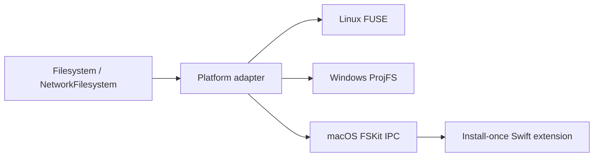

# FSBind

FSBind is a high-performance Rust library for building virtual and network
filesystems on macOS, Linux, and Windows from one data model.

- macOS: FSKit extension with an install-once Swift bridge.
- Linux: multithreaded kernel FUSE adapter.
- Windows: native ProjFS provider for lazy virtual and network trees.
- Rust: `Filesystem` and `NetworkFilesystem: Filesystem` traits.
- Native access: opt-in borrowed FSKit, FUSE, and Windows event contexts.

The common API stays deliberately small. Backends identify items with stable
64-bit inode values, stream directory entries into a caller-owned sink, and
read directly into caller-provided buffers. Names are arbitrary bytes on Unix
and WTF-8 on Windows, preserving Windows UTF-16 names including unpaired
surrogates.

The published `fsbind` crate deliberately implements neither `Filesystem` nor
`NetworkFilesystem`. It does not choose an inode index, cache, locking model,
transaction boundary, consistency policy, or storage engine for downstream
users. The workspace's memory and network backends are examples only; copy
their ideas or replace them entirely.

## Platform support

| Platform | Native layer | Model | Installation |
|---|---|---|---|
| macOS 26+ | FSKit | Full virtual filesystem; lazy network support | Install and authorize `FSBind.app` once |
| Linux | FUSE kernel protocol through `fuser` | Full virtual filesystem; lazy network support | FUSE must be available |
| Windows 10 1809+ | ProjFS | Lazy projected tree with Windows-managed local cache | Enable the Projected File System optional component |

ProjFS intentionally merges projected entries with local files. Writes and
hydrated content live in its virtualization root, while providers receive
native notifications through the raw hook. This is a particularly good fit for
source-control, cloud, content-addressed, and other network-backed trees. A
fully synthetic Windows filesystem with provider-owned write semantics would
use WinFsp; FSBind exposes the Windows-native callback context in a form that
does not prevent a WinFsp adapter from being added without changing the common
model.

## Implement a filesystem

```rust
use fsbind::{Filesystem, MountSession};

struct MyCoolFilesystem;

impl Filesystem for MyCoolFilesystem {
    fn statfs(&self) -> fsbind::Result<fsbind::StatFs> {
        todo!()
    }

    fn metadata(&self, inode: u64) -> fsbind::Result<fsbind::Metadata> {
        todo!()
    }

    fn lookup(
        &self,
        parent: u64,
        name: &[u8],
    ) -> fsbind::Result<(u64, fsbind::FileType)> {
        todo!()
    }

    fn read_directory(
        &self,
        inode: u64,
        cookie: u64,
        verifier: u64,
        sink: &mut dyn fsbind::DirectorySink,
    ) -> fsbind::Result<fsbind::ReadDirectoryResult> {
        todo!()
    }

    fn read(
        &self,
        inode: u64,
        offset: u64,
        output: &mut [u8],
    ) -> fsbind::Result<usize> {
        todo!()
    }
}

let mount = MountSession::mount(MyCoolFilesystem, "/path/to/mount")?;
// Keep `mount` alive. Dropping it unregisters/unmounts the filesystem.
# Ok::<(), std::io::Error>(())
```

The required methods are sufficient for a read-only filesystem. Mutation
methods default to `ENOTSUP`. Methods can run concurrently, so implementations
must be `Send + Sync`.

The workspace's memory example is a complete CLI and a deliberately separate
implementation:

```sh
cargo run -p fsbind-memory-backend -- /path/to/mount
```

Control-C performs an orderly unmount. The same executable builds against the
native adapter selected by its target OS.

## Network filesystems and downloaded files

```rust
use fsbind::{LocalFile, NetworkFile, NetworkFilesystem};

impl NetworkFilesystem for MyCoolFilesystem {
    fn open_file(
        &self,
        inode: u64,
        _writable: bool,
    ) -> fsbind::Result<NetworkFile> {
        if let Some(download) = self.downloaded_file(inode) {
            return Ok(NetworkFile::Local(LocalFile::new(
                download.path,
                download.generation,
            )));
        }
        Ok(NetworkFile::Remote)
    }

    fn close_file(
        &self,
        inode: u64,
        file: NetworkFile,
    ) -> fsbind::Result<()> {
        self.download_manager.file_closed(inode, file);
        Ok(())
    }
}

let mount = fsbind::MountSession::mount_network(
    MyCoolFilesystem::connect()?,
    "/path/to/mount",
)?;
# Ok::<(), std::io::Error>(())
```

`NetworkFile::Remote` keeps reads lazy through `Filesystem::read`.
`NetworkFile::Local` leases an explicitly downloaded file until `close_file`,
letting the backend track activity and perform its own eviction.

- macOS reads leased local files with `pread`, bypassing IPC.
- Linux reads the local descriptor directly on its FUSE worker.
- Windows ProjFS manages its virtualization root as the local hydration cache.

## Native requests without default overhead

Implementers can inspect platform-specific events without forcing every
filesystem through an allocation-heavy universal request object:

```rust
use fsbind::raw::{
    NativeRequest, Operation, RawEvent, RawEventMask, RawOutcome,
};

impl Filesystem for MyCoolFilesystem {
    // common methods...

    fn raw_event_mask(&self) -> RawEventMask {
        RawEventMask::operation(Operation::Open)
            .union(RawEventMask::operation(Operation::Write))
    }

    fn raw_event(&self, event: RawEvent<'_>) -> RawOutcome {
        match event.native {
            NativeRequest::Linux {
                request,
                unique,
                file_handle,
                flags,
            } => {
                // `request` points to the borrowed fuser::Request.
            }
            NativeRequest::Windows {
                callback_data,
                namespace_context,
                command_id,
                flags,
            } => {
                // Live PRJ_CALLBACK_DATA and virtualization context.
            }
            NativeRequest::MacOS {
                request_id,
                item_id,
                flags,
                payload,
            } => {
                // Exact borrowed bridge payload and stable FSKit identifiers.
            }
        }
        RawOutcome::Continue
    }
}
```

The mask is fetched once when mounting. When it is empty, adapters take one
predictable bit test and do not construct an event or call the hook. Buffers
are borrowed in place:

- Linux exposes the live `fuser::Request` and read/write buffer.
- Windows exposes `PRJ_CALLBACK_DATA`, namespace context, command ID, and
  ProjFS-aligned hydration buffer.
- macOS exposes exact bridge payloads, request/item identifiers, and flags.
  FSKit Objective-C pointers cannot be validly exposed to a separate Rust
  process, so the bridge never presents unsafe cross-process pointer values.

Raw pointers and buffers are valid only for the synchronous hook call.

## Architecture



macOS mounts use a mode-0600 Unix socket in the FSBind App Group container and
a random per-mount capability. The extension pools up to one persistent
connection per active CPU. Linux uses multiple FUSE event loops and
`FUSE_DEV_IOC_CLONE` where available. Windows lets ProjFS select or configure
native callback workers.

## Performance

The hot paths avoid serialization frameworks and per-item calls:

- caller-owned read buffers and borrowed write buffers;
- packed directory batches on macOS;
- reusable thread-local FUSE read buffers on Linux;
- ProjFS-aligned buffers written directly with `PrjWriteFileData` on Windows;
- fixed little-endian IPC frames rather than JSON or Codable;
- `writev` for macOS response headers and payloads;
- stable directory cookies and mutation verifiers;
- no raw-event allocation or virtual call unless its operation is enabled.

The storage-engine figures below measure the example implementation, not a
policy imposed by `fsbind`. Benchmarks were run on an Apple M1 Pro using
release builds:

| Benchmark | Observed result |
|---|---:|
| In-memory lookup | 17.2 million operations/s median |
| 128 KiB reads | 49.5 GiB/s median |
| 10,001-entry directory | 403 million entries/s median |
| Raw hooks disabled | Within run-to-run noise of direct dispatch |
| Authenticated macOS IPC lookup | 188 thousand round trips/s median |

Changing macOS response writes from two syscalls to vectored I/O improved the
authenticated lookup result from a 162–169k baseline to 182–196k round trips/s
(roughly 12–15% by median, depending on the run). A round trip is about
5.1–5.5 µs on this machine.

Run the same benchmarks locally:

```sh
cargo run --release -p fsbind-memory-backend --example throughput
cargo run --release -p fsbind-memory-backend --example raw_overhead
cargo test --release -p fsbind \
  ipc::tests::benchmark_authenticated_ipc_lookup_roundtrip \
  -- --ignored --nocapture
```

These isolate backend and dispatch costs. Mounted performance also includes the
host kernel, FUSE/FSKit/ProjFS, cache state, and the downstream backend; use
`fio`, Instruments, `fs_usage`, or platform equivalents for deployment-specific
measurements.

## Building and testing

Rust requires version 1.85 or later.

```sh
cargo test --workspace --all-targets
cargo clippy --workspace --all-targets -- -D warnings

cargo check --workspace --all-targets \
  --target x86_64-unknown-linux-gnu
cargo check --workspace --all-targets \
  --target x86_64-pc-windows-msvc
```

The CI matrix runs native Rust tests on macOS, Ubuntu, and Windows. The macOS
job also generates the Xcode project and runs the Swift bridge tests.

### macOS bridge

macOS additionally requires Xcode 26, XcodeGen, and an Apple team capable of
signing `com.apple.developer.fskit.fsmodule`.

```sh
(cd fsbind/macos && xcodegen generate)
./fsbind/macos/check.sh
```

Install `FSBind.app`, then enable it under **System Settings → General → Login
Items & Extensions → File System Extensions**. A CLI can query and open the
authorization guide:

```rust
match fsbind::authorization_status()? {
    fsbind::AuthorizationStatus::Authorized => {}
    fsbind::AuthorizationStatus::NeedsApproval => {
        fsbind::open_authorization_app()?;
    }
    fsbind::AuthorizationStatus::NotInstalled => {
        eprintln!("Install FSBind.app in /Applications");
    }
}
# Ok::<(), std::io::Error>(())
```

Set `FSBIND_APP_PATH` while testing an app outside `/Applications`.

### Windows

Enable **Projected File System** in “Turn Windows features on or off”, or with
an administrator shell:

```powershell
Enable-WindowsOptionalFeature -Online -FeatureName Client-ProjFS
```

ProjFS requires an empty or previously initialized virtualization root.

## Signed macOS releases

Tags matching `v*` build, sign, notarize, staple, and upload `FSBind.app`.
Configure:

- `BUILD_CERTIFICATE_BASE64`
- `P12_PASSWORD`
- `KEYCHAIN_PASSWORD`
- `APP_PROVISIONING_PROFILE_BASE64`
- `EXTENSION_PROVISIONING_PROFILE_BASE64`
- `APPLE_TEAM_ID`
- `APPLE_ID`
- `APPLE_APP_SPECIFIC_PASSWORD`

Both App IDs and profiles must include the
`group.com.specta.fsbind` App Group.

FSKit still requires its `.appex` inside a signed `.app`; a CLI cannot contain
the extension as a raw executable. The companion app is installed once and can
serve any number of independent Rust mount processes.
